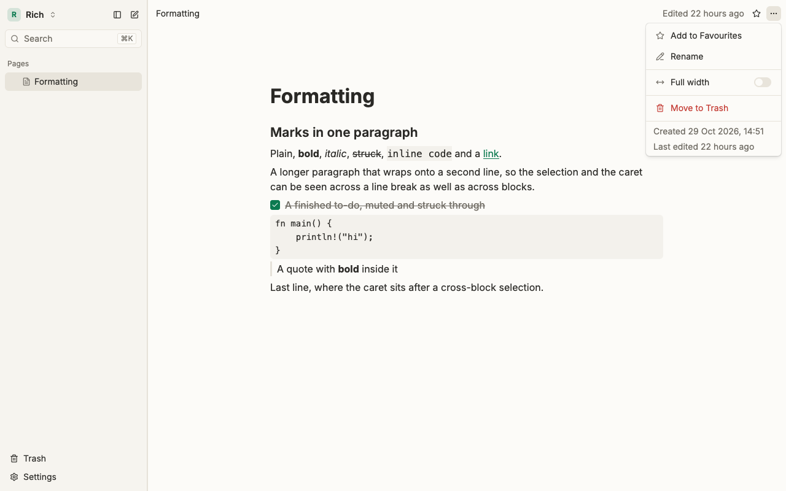
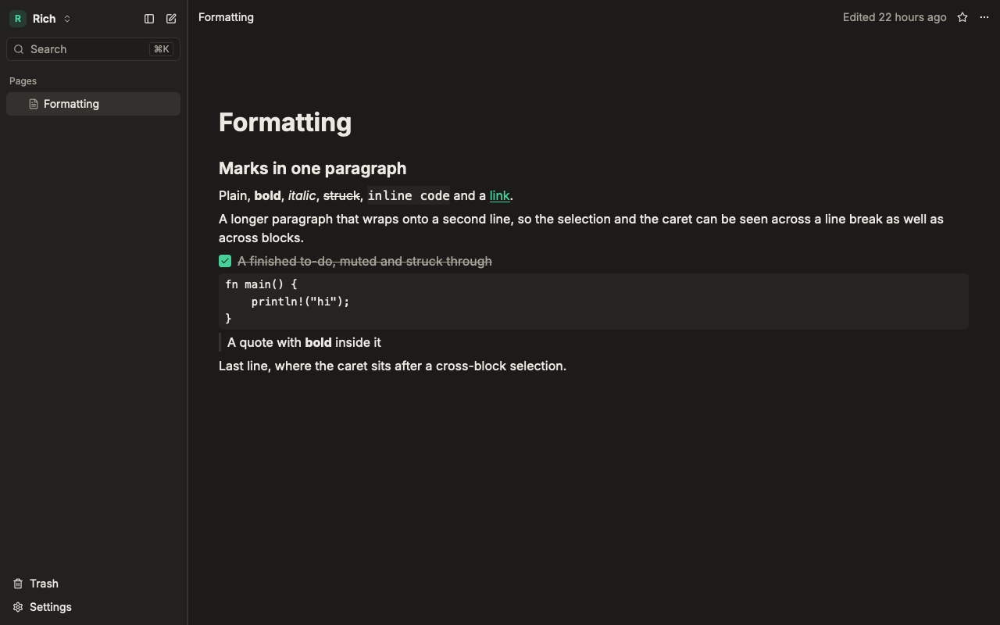

<div align="center">

# 🍃 Leaf

**A fast, native, local-first alternative to Notion.**

Notion's flexibility, Obsidian's speed and ownership, no browser in the way.

[](https://github.com/milinpaul/project-leaf/actions/workflows/ci.yml)
[](#license)





</div>

---

## Why Leaf?

- **Native speed.** Written in Rust and drawn on the GPU with [GPUI](https://www.gpui.rs/). No webview, no
  Electron. A keystroke on a 10,000-block page takes under 16 ms.
- **Local-first.** Leaf works fully offline. Your workspace is a folder on your computer, not a row in someone
  else's database. Phase 0 makes no network requests at all.
- **Nothing lost.** Every change is saved as you type. A crash or a force-quit loses nothing.
- **Pages all the way down.** There are no folders: any page can hold pages.
- **Collaboration-ready.** Documents are [Loro](https://loro.dev/) CRDTs from day one, so sync can come later
  without rewriting the data model.
- **Keyboard-first.** Everything is reachable without a mouse.

## Status

Leaf is **pre-alpha**. Phase 0 is the page editor, and it is close to done. It is good enough to write in daily,
but the file format may still change, so keep backups of anything you care about.

There are no prebuilt downloads yet; you build Leaf from source (see [Install](#install)).

### What works today (Phase 0)

| Area | Features |
|---|---|
| **Workspaces and pages** | Workspaces stored as local folders, a sidebar page tree (nest, drag, reorder), page icons and covers, favourites, trash and restore, full-width pages |
| **Blocks** | Paragraphs, headings 1–3, bulleted, numbered and to-do lists, quotes, code (with a language label), dividers, images, simple tables and action items |
| **Editing** | Slash menu (`/`), markdown shortcuts (`# `, `- `, `[] `, ```` ``` ````…), bold, italic, strike, inline code and links, drag handles, `Tab` to nest, undo and redo for every edit |
| **Search** | `Cmd/Ctrl+K` finds pages by title and by the text inside them, ignoring case and accents |
| **Look and feel** | Light and dark themes, a resizable sidebar, a top bar with breadcrumbs and "Edited 3 minutes ago" |

### Roadmap

| Phase | What it brings |
|---|---|
| **0: Page editor** (now) | Write a long document with zero friction and zero lost text |
| **1: MVP** | Databases (table view), `[[page links]]` and backlinks, markdown import and export, bookmarks |
| **2** | Board, calendar and gallery views, templates, cloud sync and team workspaces, a read-only web viewer |
| **3** | A full web editor kept in sync with the desktop app |

The full plan is in [docs/product/PRODUCT_SPEC.md](docs/product/PRODUCT_SPEC.md), and every piece of work is a
story in [`backlog/`](backlog/README.md).

## Install

Leaf builds on macOS, Linux and Windows. You need:

1. **Rust**, installed with [rustup](https://rustup.rs/). The repository pins its compiler version in
   `rust-toolchain.toml`, so rustup downloads the right one by itself on the first build.
2. **[just](https://github.com/casey/just)**, the task runner: `cargo install just` (or `brew install just`).
3. Your platform's build tools:
   - **macOS:** the Xcode command line tools: `xcode-select --install`. Full Xcode is not needed.
   - **Linux (Debian/Ubuntu):** the GPUI system libraries:
     ```bash
     sudo apt-get install clang pkg-config libssl-dev libxkbcommon-dev libxkbcommon-x11-dev libwayland-dev libx11-xcb-dev libxcb1-dev libvulkan-dev libfontconfig-dev libfreetype-dev libasound2-dev libzstd-dev
     ```
     Other distributions need the equivalent packages ([the CI list](.github/scripts/linux-deps.sh)).
   - **Windows:** the [Visual Studio C++ build tools](https://visualstudio.microsoft.com/visual-cpp-build-tools/)
     (rustup offers to install them).

Then get the code:

```bash
git clone https://github.com/milinpaul/project-leaf.git
cd project-leaf
```

### Run it

```bash
just run
```

The first build takes a few minutes. Leaf opens and asks you to create or open a workspace: pick any empty
folder.

### Install it as an app (macOS)

```bash
just install
```

This builds an optimised Leaf and puts it in `/Applications/Leaf.app`. Run it again to update after a
`git pull`.

On Linux and Windows, build the optimised binary with `cargo build --release -p leaf-app`; it is written to
`target/release/leaf-app` (`leaf-app.exe` on Windows).

## Where your data lives

A workspace is an ordinary folder you choose (`MyWorkspace.leaf/`). Inside it, Leaf keeps your pages in
`workspace.sqlite` and your images in `assets/`; the search index beside them can always be rebuilt. Back the
folder up like any other. Leaf never uploads it anywhere.

## How it is built

| Crate | Role |
|---|---|
| `leaf-core` | Shared IDs, errors and small types |
| `leaf-model` | The document model (Loro CRDT) and the `Command`s that change it |
| `leaf-editor` | All editing rules as plain, testable Rust: keys, selection, undo, clipboard |
| `leaf-store` | Saving workspaces to SQLite, crash recovery |
| `leaf-search` | The full-text search index |
| `leaf-export` | Markdown export (Phase 1) |
| `leaf-ui` | GPUI views that draw the editor's view models and forward input |
| `leaf-app` | The executable that wires it all together |

The core crates never depend on the UI, and they compile to WebAssembly, ready for the web editor later. Start
with [ARCHITECTURE.md](docs/architecture/ARCHITECTURE.md), which follows a keystroke all the way to a saved
change in plain English. [docs/README.md](docs/README.md) maps the rest of the documentation, and
[docs/adr/](docs/adr/) records why things are the way they are.

## Contributing

Issues and pull requests are welcome! Read [CONTRIBUTING.md](CONTRIBUTING.md) for the dev setup and the rules a
PR has to meet.

- **Found a bug?** [Open an issue](https://github.com/milinpaul/project-leaf/issues/new/choose) with the steps
  to reproduce it.
- **Want to help?** Look for issues labelled
  [`good first issue`](https://github.com/milinpaul/project-leaf/labels/good%20first%20issue), or browse
  stories marked `todo` in [`backlog/stories/`](backlog/stories/).
- **Have an idea?** Open a feature request. Please check the [roadmap](#roadmap) and the
  [product spec](docs/product/PRODUCT_SPEC.md) first.

Please follow our [Code of Conduct](CODE_OF_CONDUCT.md). To report a security problem, see
[SECURITY.md](SECURITY.md).

## License

Leaf is licensed under either of

- [Apache License, Version 2.0](LICENSE-APACHE)
- [MIT license](LICENSE-MIT)

at your option.

Unless you explicitly state otherwise, any contribution you intentionally submit for inclusion in Leaf, as
defined in the Apache-2.0 license, is dual licensed as above, without any additional terms or conditions.

"Leaf" is a codename and may change.
