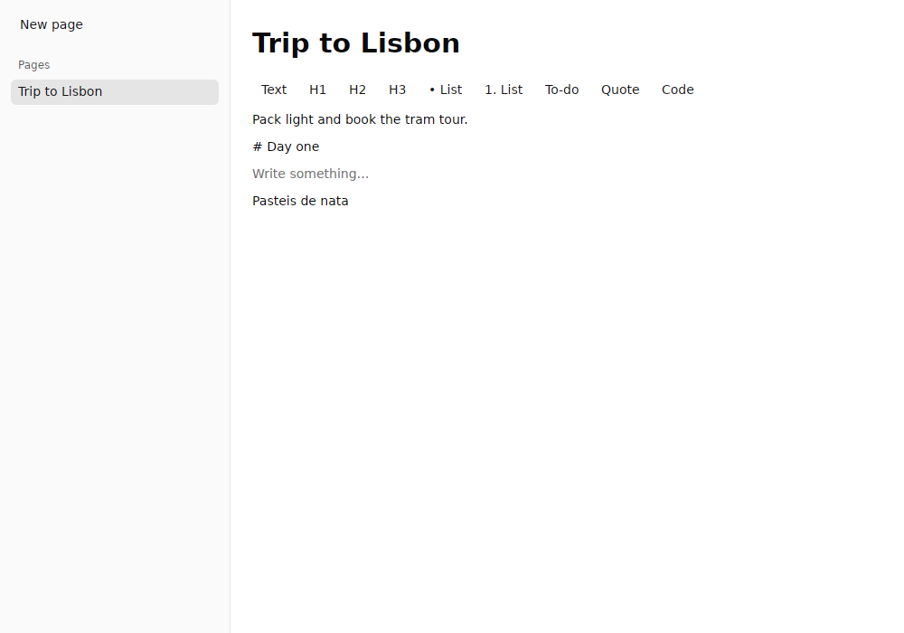
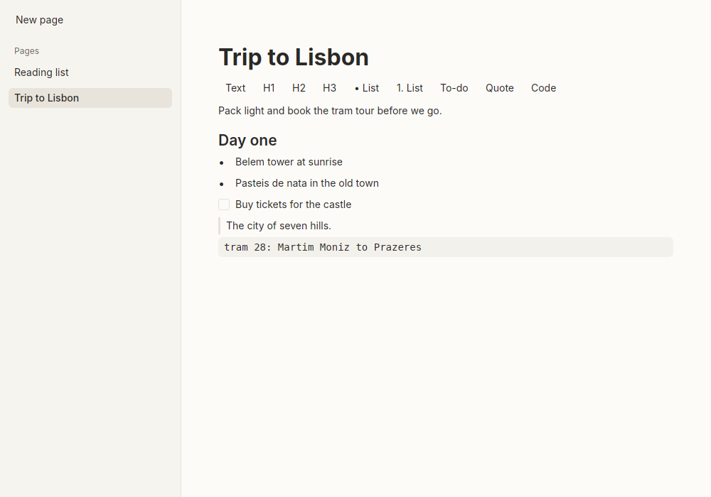
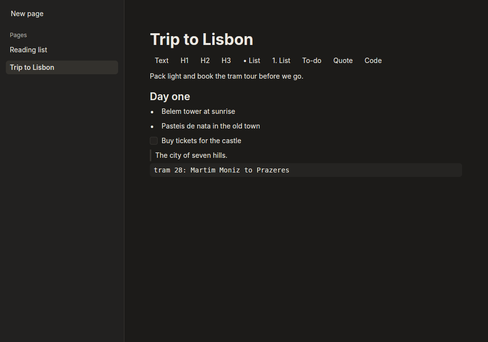

# 0027. Leaf's visual identity: warm paper, Inter throughout, green used sparingly

- **Status:** Accepted
- **Type:** Feature
- **Date:** 2026-10-29
- **Story:** E06-S01

## Context

Leaf drew with gpui-component's default theme: correct, but generic. The goal is for Leaf to look premium (like
Notion, Linear, Things or Bear) without copying any of them. The owner was interviewed on personality, neutrals,
accent, dark mode, type, corners, density and green. The app icon already gives Leaf a colour: an emerald gradient
(`#4BE3A0 → #16A970 → #0A6B4E`).

## Decision

All values live in one module, `crates/leaf-ui/src/theme.rs`, and are tested there.

- **Personality: warm and friendly**, shown through shape and softness (rounded corners, gentle tints, roomy
  spacing) rather than through more colour.
- **Neutrals: warm paper.** Light: page `#FCFBF8`, sidebar `#F6F4EF`, text `#2A2926`. Dark is a **soft
  charcoal**: page `#1C1B19`, sidebar `#222120`, text `#ECE9E3`. Never pure white or black.
- **Accent: the icon's green, used sparingly**: selection, caret, links, focus rings and the main button only.
  Deepened to `#0B7A50` in light mode so text in it is readable; brightened to `#45D199` in dark mode.
- **Type: Inter for everything**: interface, body text (16 px, line height 1.6), page titles (32 px, bold) and
  headings (26, 21, 18 px, semibold). One family keeps pages calm; hierarchy comes from size and weight. Bundled
  (SIL Open Font License, five weights, about 2 MB) so Leaf looks the same on every OS.
- **Shape and space:** 6 px corners (8 px for large surfaces), no drop shadows, a reading column at most 720 px
  wide, extra space above headings.
- **Light and dark follow the system**, and switch live when the OS does. `LEAF_APPEARANCE=light|dark` forces one,
  for screenshots.
- **Contrast is a test:** every text/background pair meets WCAG AA (4.5:1 for text, 3:1 for the caret) in both
  modes, and the accent must stay within a few degrees of the icon's hue.

Before, light and dark:

## Alternatives considered

- **Crisp and precise (cool greys, tight spacing, like Linear):** sharper, but colder than the owner wanted.
- **Green shown prominently (tinted sidebar, green headers):** strong identity, but it competes with the owner's
  own writing, which should be the most colourful thing on screen.
- **System fonts:** native and free, but Leaf would look different on each OS, especially across Linux distros.
- **Serif headings (Source Serif 4) with Inter text:** tried first, from the interview. On screen the serif
  headings looked out of place next to Inter, so the owner chose Inter throughout.
- **How it differs from Notion:** warm paper instead of white, Inter instead of the system font, a green accent
  from Leaf's own icon, and a warmer, softer dark charcoal. The layout (sidebar plus page) is common to the genre.

## Consequences

- **Pointers** (E07-S12): the I-beam over the page's text and title, the hand over everything clickable (buttons,
  checkboxes, sidebar rows, menu rows, pickers), the arrow elsewhere. Every button is made with `theme::button`,
  which adds the hand that gpui-component's buttons leave out; a test fails if one is made with `Button::new`.

- Changing the look means editing one file; screens ask for roles ("muted text") rather than colours.
- The binary grows by about 2 MB of fonts. More weights can be added later if needed.
- The interim block editor (E07-S10) and the formatting toolbar will be restyled when their real versions land.
- Plain English: Leaf now has its own look, like a calm notebook on warm paper with a touch of its leaf-green,
  one clean modern typeface throughout, and a soft dark mode that follows your computer's setting.

## Update 2026-10-31 (E08-S08)

Code blocks and inline code use a bundled monospace face, JetBrains Mono NL, instead of the system's (ADR 0076).
