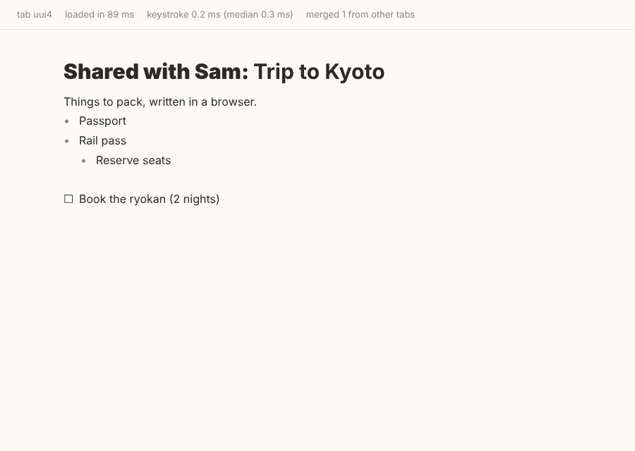
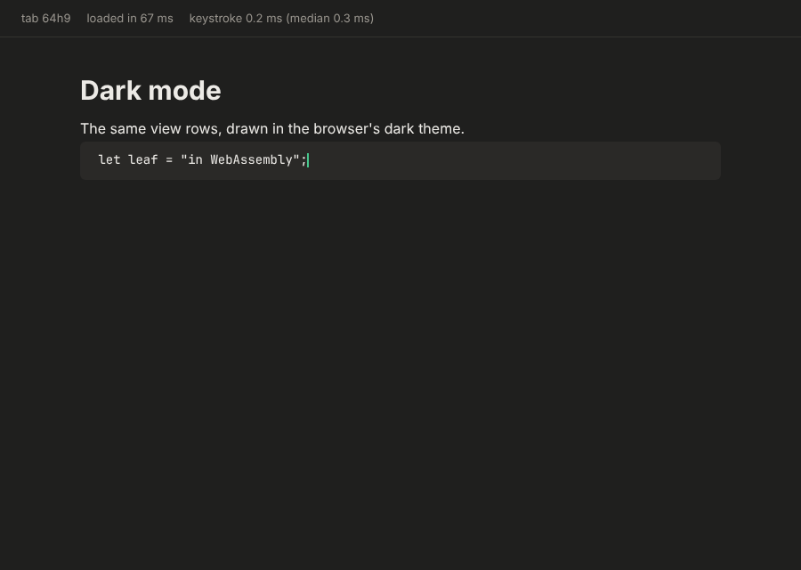

# Spike: the web editor (E14-S01)

**Question:** how close is Leaf to editing a page in a web browser, kept in step with other copies? What works
already, what is missing, and how should the E14 work be broken up?

**Short answer:** closer than expected. Leaf's own editor (`leaf-editor` and `leaf-model`, unchanged) runs in
Chromium through WebAssembly. It handles typing, Enter, Backspace, Tab, arrows, undo and redo, bold and italic,
and Markdown shortcuts, and two tabs editing at once converge. It loads in under 0.1 s, and a keystroke costs
0.2–0.3 ms. What is missing is mostly the browser layer (caret placement by mouse, selection drawing, input-method
display, a fast renderer for long pages) plus two small gaps in the core crates and the whole sync server.

The spike code is in [`spikes/web-editor/`](../../spikes/web-editor/README.md). It is throwaway and outside the
workspace build.

| Tab A, while tab B added the bold words | Dark mode, code block |
|---|---|
|  |  |

## What was built

- **A WebAssembly module** (`leaf-web-spike`, about 200 lines of Rust with `wasm-bindgen`) that wraps one
  `PageEditor`.
  - The browser forwards what the person does: typed text from a hidden `<textarea>`, and named keys with Shift and
    Cmd/Ctrl.
  - It redraws from `PageEditor::view()`, the same view rows the desktop app draws. The module turns them into HTML.
  - No document logic is written in JavaScript: the core crates decide everything, as on desktop (rules 2 and 3).
- **A plain HTML page and a small script**, with no framework. The page uses Leaf's paper colours and follows the
  browser's light or dark setting.
- **Sync between tabs** over a `BroadcastChannel`, with no server.
  - After each change a tab sends its whole Loro snapshot; the others merge it in.
  - A new tab opens the page from an existing tab's copy instead of creating its own.
- **A Playwright script** (`drive.cjs`) that types in two tabs at once and checks they converge.

## Measurements

Taken in headless Chromium on the Linux build machine.

| What | Result |
|---|---|
| WebAssembly download | **3.4 MB** raw, **1.0 MB** gzip (release, `opt-level = "s"`, LTO; `wasm-opt` not yet run) |
| JavaScript glue | 17 KB |
| Load to editable page | 60–90 ms after the files arrive |
| One keystroke in the core (type, Enter, Backspace…) | median **0.3 ms** on a small page, **0.2 ms** on a 400-block page |
| Redrawing a 400-block page as HTML | 1.3 ms |
| Two tabs typing at the same moment | converged to the same text every run |

The core is not the bottleneck: a keystroke uses about 2% of a 16 ms frame. The download is acceptable for an app
(one load, then cached) but worth trimming. `wasm-opt -Oz` usually saves 20–30%, and Loro is the largest part.

## What already works, unchanged

- The core crates compile and run in the browser. `uuid` gets randomness from the browser (`js` feature), and the
  clock is passed in as `now_ms`, so nothing needs threads or the file system.
- Typing, keys, undo and redo, formatting, Markdown shortcuts and nesting behave exactly as on desktop: it is the
  same code.
- Merging copies: Loro takes in another copy's snapshot and the page converges, including concurrent edits in the
  same line.

## Gaps found in the core crates

These are small, and the desktop app needs them too, for sync:

1. **No way to take in remote changes while editing.** `PageEditor` owns its `PageDoc` and has no public
   `apply_remote(bytes)`. The spike rebuilds the editor around the merged document, which keeps the caret but
   **loses undo history on every merge**. Needed: a `PageEditor` method that imports changes, keeps the caret and
   the selection anchored, and keeps local undo working (Loro's undo manager supports that).
2. **Only whole snapshots can be exported.** `PageDoc::to_bytes` sends the whole document. Sync needs "updates since
   version X" (Loro's `export(ExportMode::updates(&vv))`) and a version vector to remember what each side has seen.
3. **A page must be created once.** Two copies that each create "a new page" and then merge end up with both first
   lines. Pages must come from one place (the server, or the desktop that made them), and a new copy starts from it.
   This is already true for desktop pages; the web client must follow it.

## Gaps in the browser layer (the real work of E14)

1. **Caret placement and movement by layout.** Click-to-place, Up and Down, and selection by dragging need text
   positions. Desktop answers these through the `LineLayout` trait (ADR-016). The web needs an implementation that
   reads the DOM (`Range.getClientRects`, `caretPositionFromPoint`).
2. **Selection drawing,** for both text ranges and whole blocks, from `PageEditor`'s selection (not the browser's).
3. **Input methods and mobile keyboards.** The spike types composed text only when composition ends. The editor
   needs the preedit shown inline (`PageEditor` already supports preedit for desktop), and the hidden textarea must
   follow the caret so candidate windows appear in the right place. Mobile Safari and Android keyboards need
   testing early: they are the riskiest part of any custom editor.
4. **A renderer that scales.** Replacing the HTML of the whole page is fine at 400 blocks (1.3 ms), not at 10,000.
   Needed: keyed per-row updates driven by `PageView`'s incremental diffs (ADR-014), and a virtual list like the
   desktop's (ADR-035).
5. **Every block kind and the pickers:** images and assets over HTTP, tables, callouts, action items, page links,
   the slash menu, block menu, link popover, emoji picker and formatting bar. The logic is all in `leaf-editor`
   already; each needs a web drawing.
6. **Clipboard** through the async browser clipboard API, using the HTML/Markdown/plain text Leaf already writes.

## The sync server (not built)

Direction from E14's notes, with what the spike adds:

- **Rust (`axum`, `tokio`) with Postgres.** Each page is stored as a Loro snapshot plus an append-only list of
  updates, the shape `leaf-store` uses in SQLite. Users, workspaces and permissions are ordinary tables. Images go to
  S3.
- **A WebSocket per open workspace.** A client sends updates with its version vector; the server stores them, relays
  them to the other clients of that page, and answers "what have I missed since X" on reconnect.
- **Server-side checks.** The server should load each incoming update into a `PageDoc` and run the invariants before
  relaying it, so one broken client can't corrupt everyone's page (rule 5 still applies: unknown data passes
  through).
- **The workspace document** (page tree, favourites, titles) syncs the same way as pages.
- **Shared storage code:** one storage interface for SQLite (desktop) and Postgres (server), as E14's notes say.

## Risks

| Risk | Why | Mitigation |
|---|---|---|
| Input methods and mobile keyboards | Custom editors without `contenteditable` often break Japanese, Chinese and Korean input and Android typing | A dedicated story with a test matrix (macOS, Windows, iOS, Android) before building much else |
| Download size | 1.0 MB gzip and growing with features | `wasm-opt`, Loro feature trimming, lazy-loading rarely used parts; a size budget in CI |
| Accessibility | A hidden textarea plus custom drawing hides the text from screen readers | An ARIA mirror of the page (role="textbox", live regions) designed in from the start |
| Undo with remote edits | Undo must take back only *my* changes | Loro's undo manager does this; covered by gap 1 above and two-peer property tests |
| Two UI codebases | Desktop (GPUI) and web (DOM) draw the same view models twice | Keep every rule in `leaf-editor` (already the architecture); share the theme tokens |

## Proposed E14 breakdown

In order. E13 (the read-only viewer) shares S3–S5 and could reuse them.

1. **S02: ADR for the sync protocol and server storage.** Updates and version vectors, the WebSocket messages,
   Postgres tables, auth.
2. **S03: incremental changes in the core.** `PageDoc` exports and imports updates since a version, and
   `PageEditor::apply_remote` keeps the caret, selection and local undo. Proptests with two peers. This also unblocks
   desktop sync.
3. **S04: a `leaf-web` crate** (wasm-bindgen bindings over `PageEditor` and `WorkspaceEditor`), built in CI with a
   size budget and a headless-browser smoke test.
4. **S05: a web renderer** with keyed row updates, a virtual list, all Phase 0 block kinds, and theme tokens shared
   with desktop.
5. **S06: caret and selection by layout:** a DOM `LineLayout`, click and drag to select, Up and Down, Shift+arrows.
6. **S07: input methods and mobile keyboards,** with inline preedit and a device test matrix.
7. **S08: menus and pickers on the web:** slash menu, block menu, link popover, emoji picker, formatting bar.
8. **S09: the sync server skeleton** (`axum`, Postgres): store and relay page updates, reconnect and catch-up.
9. **S10: accounts and workspaces:** sign-in, permissions, opening a workspace from the server.
10. **S11: images and assets** over S3.
11. **S12: syncing the workspace document** (page tree, favourites, titles).
12. **S13: end-to-end tests:** two browsers and a desktop client against a test server.

## Recommendation

Start with **S02 and S03**: they are small, settle the protocol, and fix the two core gaps, which the desktop needs
anyway for sync. Then decide between building the E13 viewer first (as planned) or going straight to S04–S06, since
the spike shows the editor itself is not the hard part; the browser layer is.

## Update 2026-10-31: the owner's choice

After reading the findings, the owner chose to build an **independent web app first**: Next.js around the
WebAssembly core, with pages stored in the browser, and accounts and sync later. It replaces "the E13 viewer first".
The E14 epic notes record it, and the first stories are:
- **E14-S02:** the decision record (Next.js, browser storage, where the code lives).
- **E14-S03:** the `leaf-web` crate, which closes core gaps 1 and 2 above.
- **E14-S04:** the Next.js app skeleton, one page typed and saved in the browser.

The rest of the breakdown above still applies, with S09–S12 (server, accounts, assets, workspace sync) coming after
the web app works on its own.

